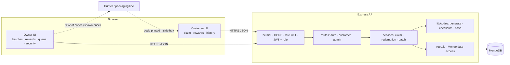
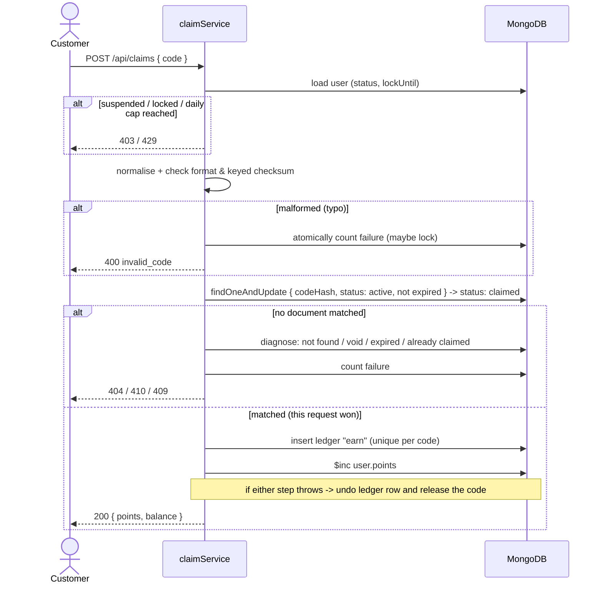
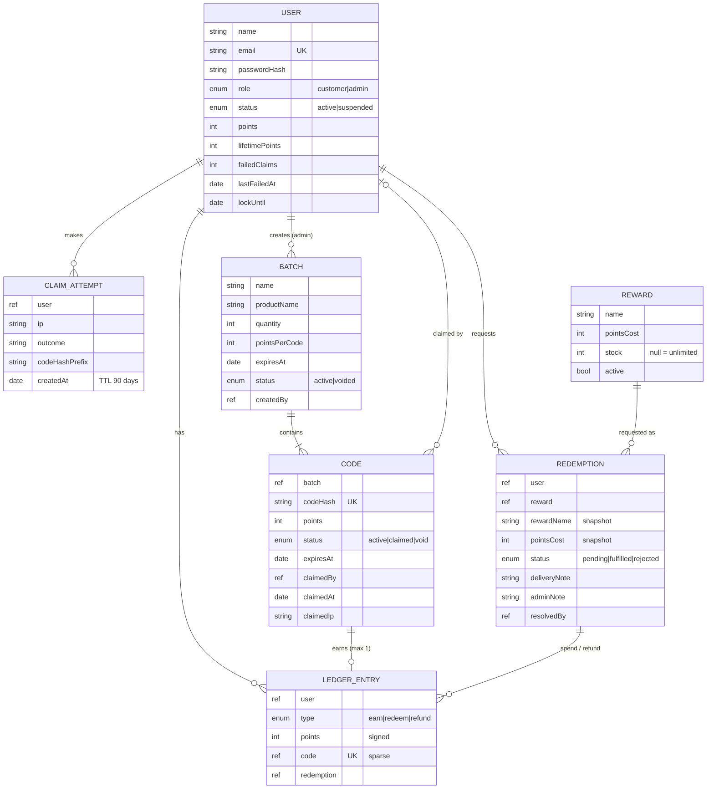

# Architecture

## 1. Stack and why

| Layer | Choice | Reason |
|---|---|---|
| Database | **MongoDB** (Mongoose) | Flexible documents suit batches/rewards; single-document atomic updates (`findOneAndUpdate`) are exactly the primitive needed for "use this code once". Free hosting on Atlas. |
| API | **Node.js + Express 4** | Small, well understood, same language as the client. Business rules live in plain service modules, not in route handlers. |
| Validation | **Zod** | One schema per endpoint; bad input never reaches the services. |
| Auth | **JWT + bcryptjs** | Stateless API, no session store. Role (`customer` / `admin`) and account status are re-read from the DB on every request, so suspending a user takes effect immediately. |
| **Client** | **React 18 + Vite + React Router** | Fast dev loop, no UI framework, custom CSS. The `qrcode` library creates the QR labels. |
| Tests | **node:test** (built in) | No test-runner dependency; services take their data access as a parameter (`deps`), so rules are tested with an in-memory store. |

**Key design choice – services take `deps`.** `claimService` and `redemptionService` never import Mongoose.
They receive an object of small data-access functions. `src/repo.js` implements it on MongoDB;
`tests/helpers/fakeStore.js` implements it in memory. That is what makes the race-condition tests possible
without a database.

## 2. System diagram

## 3. Claiming a code (the critical path)

## 4. Fraud and reuse prevention

| Threat | Control |
|---|---|
| Guessing codes | 60 random bits (≈10¹⁸). Checksum is **keyed** (HMAC with `CODE_SECRET`), so about 99.9999% of random guesses fail before any code lookup. Lockout after 5 bad attempts. IP rate limit. |
| Reusing a code / two people claiming at once | One `findOneAndUpdate` with the guard `status = active` inside the filter. MongoDB applies condition + write atomically, so only one request can ever win. A **unique sparse index** on `LedgerEntry.code` is a second barrier against double credit. |
| Database leak | Only `HMAC(secret, code)` is stored. Leaked hashes cannot be turned back into codes or redeemed. |
| Typos locking out honest users | Lock is short (15 min), checksum makes typos rare, and the owner can reinstate a user instantly. |
| Scripted bulk claiming | Daily cap per account; rate limit per IP; Security tab shows many accounts on one IP. |
| Parallel brute-force overwriting the counter | Failure counting is an atomic `$inc` (`repo.registerFailure`) – a bug found and fixed in review, see AI_LOG. |
| Stolen / mis-printed batch | Owner voids the batch: all unclaimed codes become `void` immediately. |
| Overspending points / overselling stock | Debit is `findOneAndUpdate({ points >= cost })`; stock is `findOneAndUpdate({ stock > 0 })`. Failures later in the flow refund points and return stock. |
| Double-handling a request (two admin tabs) | `pending → fulfilled/rejected` is one conditional update; the second attempt gets 409 and nothing is refunded twice. |
| Privilege escalation | Sign-up hard-codes `role: 'customer'`; admin routes check the role loaded from the DB, not from the token. |
| Account-existence leaks | Login compares against a dummy hash when the email is unknown and returns one generic message. |

## 5. Data model

Notes: `User.points` is the spendable balance (fast conditional debit); `LedgerEntry` is the append-only
history that explains it. Reward name and cost are copied onto each redemption so later catalogue edits do
not rewrite history.

## 6. Consistency without transactions

Standalone MongoDB cannot run multi-document transactions, so each flow is ordered so that the
irreversible, contended step happens first and **atomically**, and later steps are undone if they fail:

- **Claim:** flip code → add ledger row → credit points. On failure: delete ledger row, release code.
- **Redeem:** debit points → take stock → create request → add ledger row. On failure: refund, restock, delete request.
- **Reject:** flip request → refund points → ledger row → restock.

Residual risk: a process crash between steps could leave a balance and ledger out of step. Mitigation
(next step): a periodic job comparing `sum(ledger)` to `user.points`; with a replica set (Atlas is one),
the same flows can be wrapped in `session.withTransaction`.

## 7. Known limitations / next steps

- Email verification and password reset.
- httpOnly cookie sessions, refresh tokens.
- Redis-backed rate limiting for multiple instances.
- Ledger-vs-balance reconciliation job; Mongo transactions on Atlas.
- Pagination on admin tables (currently the latest 100–200 rows).
- Browser/E2E tests (Playwright) for the UI.
